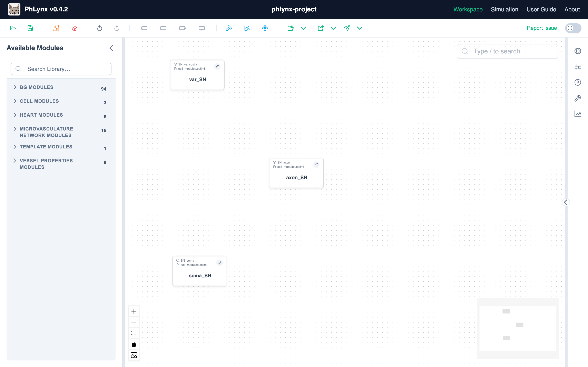
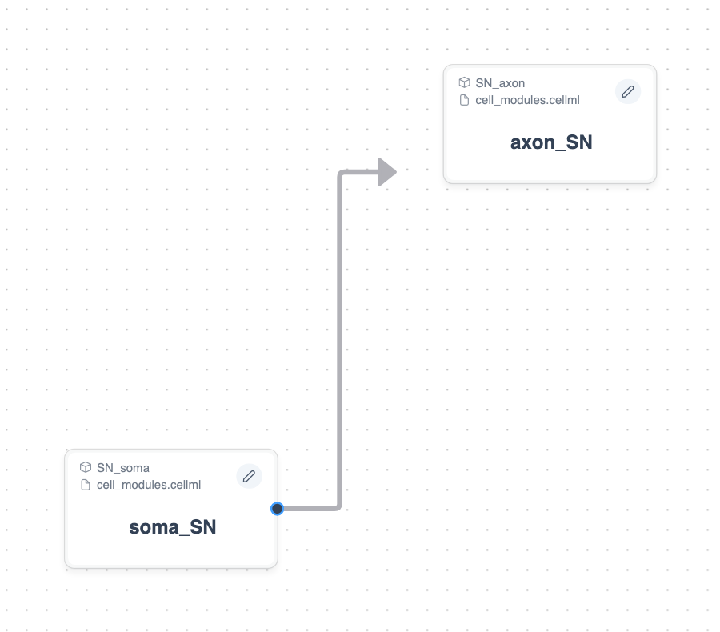
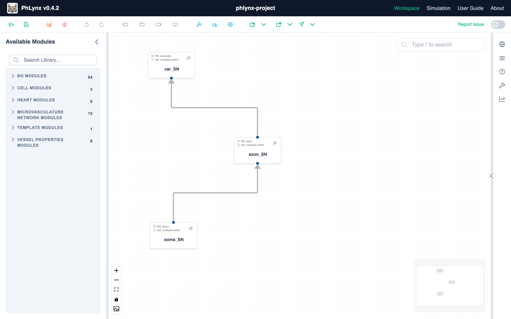

# Quick Start Guide

Build, simulate and export a small three-module nerve model.

## Layout

| Area | Where | Use |
| :--- | :--- | :--- |
| [Toolbar](../reference/ui-overview.md#toolbar) | Top | Load, save, import, export and edit tools |
| [Available Modules](../reference/ui-overview.md#module-library) | Left | Search and drag <GlossaryLink term="modules"/> |
| [Workspace](../reference/ui-overview.md#workspace) | Centre | Assemble the model |
| [Context Sidebar](../reference/ui-overview.md#context-sidebar) | Right (icon rail) | Parameters, properties and simulation |

{.align-center width="800px"}

## Step 1: Place and Rename {#step-1}

1. Download <a href="/examples/cell_modules.cellml" download>cell_modules.cellml</a>.
2. Import it with **Import ▸ CellML File**, or drop the file onto the canvas. A **CELL MODULES** group appears in Available Modules.
3. Expand the group (or search for `SN_`) and drag **SN_soma**, **SN_axon** and **SN_varicosity** onto the Workspace. Each placed copy is an *instance*.

   {.align-center width="800px"}

4. Click each instance's name and rename it: **SN_soma** to **soma_SN**, **SN_axon** to **axon_SN**, **SN_varicosity** to **var_SN**. (Double-clicking the node opens the Instance Editor instead.)

To use your own modules, see [Using Custom Modules](../guides/build-custom-module.md).

## Step 2: Connect {#step-2}

Hover over a node's edge until a green handle appears, then drag it to another node's edge. This creates the handles on both nodes and the connection. To remove a handle, hover over it and click the trash icon.

{.align-center width="550px"}

Connect the three instances as shown:

{.align-center width="800px"}

## Step 3: Configure Ports {#step-3}

<GlossaryLink term="ports"/> say which variables a connection shares. For each instance:

1. Click **Edit instance** (pencil icon) on the node to open the [Instance Editor](../reference/ui-overview.md#instance-editor), then open its **Ports** tab.
2. Click **Add port** for each row below. Set **Type** (I = input, O = output), **Label** and **Variables**. Leave **Mode** on Basicport (one connection per port).
3. Click **Save**.

Connected ports must share the same label. See [Port Logic](../reference/valid-port-configurations.md#port-types) for the type rules.

{.align-center width="800px"}

**var_SN**

| Type | Label | Variables |
| :--- | :--- | :--- |
| I | membrane_voltage | V |
| O | synaptic_NE | NE |

**axon_SN**

| Type | Label | Variables |
| :--- | :--- | :--- |
| I | VI_port | V_in, I |
| O | membrane_voltage | V |

**soma_SN**

| Type | Label | Variables |
| :--- | :--- | :--- |
| I | i_stim | I_in |
| O | VI_port | V, I_out |

## Simulate

1. Click **Simulation** (chart icon) on the right-hand rail. The scope switch should read **Whole model**.
2. Click **Simulate the whole model** (play icon), or press F9 while the panel has focus.
3. Click **Add a variable here** (plus icon) beside a plot name to choose what to plot, e.g. soma_SN's V.

{.align-center width="550px"}

Sliders, tracked runs, protocols and sweeps are covered in [Simulating Your Model](../guides/simulating-your-model.md).

## Save and Export

- **Save:** click **Save workspace** (floppy-disk icon) or press Ctrl/Cmd+S. This saves a JSON file with the whole workspace, including simulation settings. Reopen it with **Load workspace** (folder icon).
- **Export:** open the arrow menu of **Export** (to the right of Import) and choose **CellML** for a flattened CellML 2.0 model. Other formats are listed in the [Interface Overview](../reference/ui-overview.md#export).
- **Open in OpenCOR:** click **Send to OpenCOR** (paper-plane icon) to open the model in Web OpenCOR.
