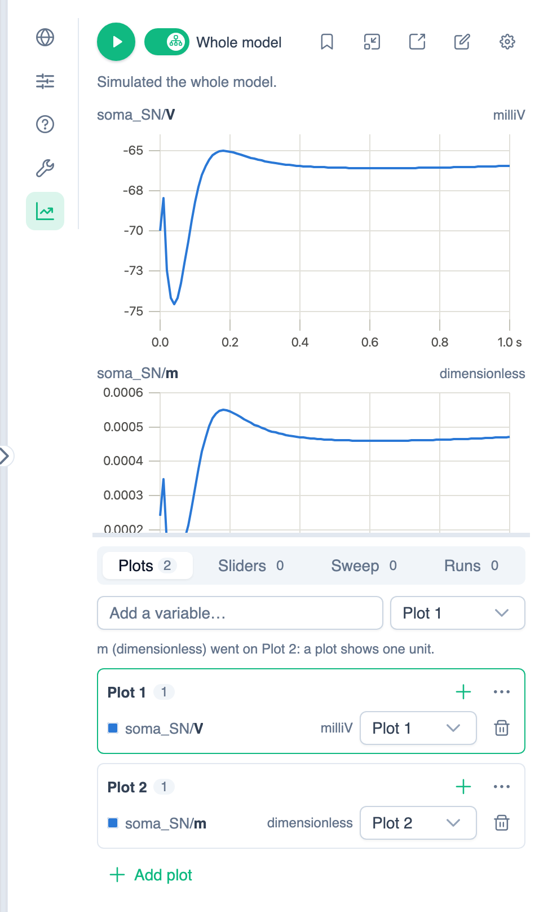

# Simulating Your Model

PhLynx runs and plots your model in-app. Three places share the same controls, and each adds its own:

| Place | Open with | Adds |
| :--- | :--- | :--- |
| **Simulation** tab, [Context Sidebar](../reference/ui-overview.md#context-sidebar) | Chart icon | **Selection** scope, floating viewer, page link |
| **Plot** tab, [Instance Editor](../reference/ui-overview.md#instance-editor) | Editing an instance | **This instance** scope, **Auto-update** |
| `/simulation` page | **Open the simulation page** (external-link icon) in the sidebar | Run settings, run-mode switch, downloads |

Every control is listed in the [Simulation UI Reference](../reference/simulation-ui-overview.md).

{.align-center width="800px"}

## Running a Simulation

1. Choose a scope: **Whole model**, or select instances on the canvas and switch to **Selection**.
2. Press **Play** (F9). A dot on Play means the results are out of date, for example after the selection changes.
3. Add variables in **Plots** and sliders in **Sliders**. Moving a slider reruns the model.

> [!NOTE]
> When you simulate a selection, Sum/Multiply inputs that are cut off are dropped, with a warning. A boundary condition with no supplier and no value is set to 0 for that run.

## Plotting from the Math

In the Instance Editor's **Plot** tab, with **Auto-update** on (the default), click a variable in the CellML Text or Math Editor to plot it alone. Runs use the saved instance, so click **Save to include your edits** first. To plot several variables, turn Auto-update off and add them from the search. This chart isn't saved to the workspace.

## Comparing, Protocols and Sweeps

* **Track this run** (bookmark icon) keeps the current lines on the charts, dashed, while you try other values. See [Tracked Runs](../reference/simulation-ui-overview.md#tracked-runs).
* A **protocol** runs a set of experiments. See [Running Protocols](./running-protocols.md).
* A **sweep** runs over a range of one parameter, set up in the **Sweep** view. See [Sweep](../reference/simulation-ui-overview.md#sweep).

## Floating Viewer and Simulation Page

* **Float over the canvas** (window icon) shows the results in a small window, so you can keep building. See [Floating Viewer](../reference/simulation-ui-overview.md#floating-viewer).
* The [simulation page](../reference/simulation-ui-overview.md#simulation-page) has larger charts, the run settings and the [CSV, PNG and SED-ML downloads](../reference/simulation-ui-overview.md#downloads).
