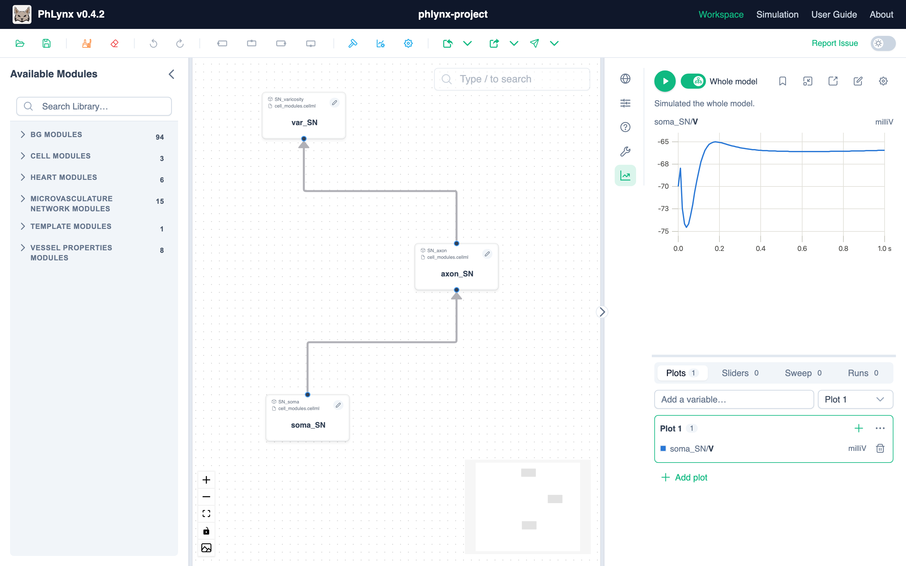
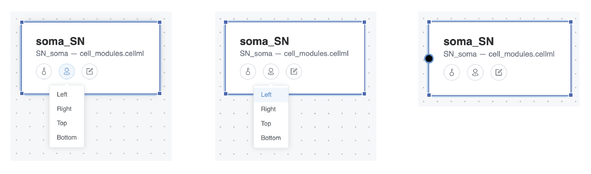

# Interface Overview

This page summarizes all user interface elements in the Workbench view of PhLynx.

## Workbench Overview

The Workbench is the primary interface for building and configuring models. It is divided into four main interaction areas:

* **[Toolbar](../reference/ui-overview#toolbar) (Top):** Tools for file management, importing/exporting, and general workspace operations.
* **[Module List](../reference/ui-overview#module-list) (Left):** A library of imported <GlossaryLink term="modules"/> available for use.
* **[Workspace](../reference/ui-overview#workspace) (Centre):** The canvas where you assemble, configure, and connect your model components.
* **[Context Sidebar](../reference/ui-overview#context-sidebar) (Right):** Inspects and simulates whatever is selected on the canvas.

These areas are highlighted in the image below:

{.align-center width="600px"}

---

## Toolbar

The toolbar provides essential controls for managing your project files and workspace state.

### File Management

#### Load Workspace
Restores a previously saved PhLynx workspace.
* **Action:** Opens a file dialog to select a `.json` workspace file.
* **Result:** Restores module positions, definitions, connections, and visual customizations (colors/names).

#### Save Workspace
Saves the current state of your project.
* **Action:** Downloads a `.json` file to your browser's default download folder.
* **Result:** Preserves the current workspace state for later restoration.

### Edit Operations

* **Undo (`Ctrl+Z`):** Reverses the last action.
* **Redo (`Ctrl+Shift+Z`):** Reapplies the last undone action.
* **Macro Build:** Enters the Macro Build component. See the [Macro Build Guide](../guides/macro-build-guide) for details.

### Import

The Import menu allows you to bring various file types into PhLynx.

#### 1. Instance Array
Populates the workspace using a [module array](./file-types#instance-array) file.
* **Supported Format:** `.csv`
* **Result:** Automatically populates the workspace with configured and connected modules based on the array definition.

> [!NOTE]
> If PhLynx does not recognize component types within the array, you may be prompted to provide additional module files.

#### 2. CellML File
Imports [CellML](./cellml-module-format) components to the Module List, **and** any [units](./cellml-units-file) the same file defines to the Units library.
* **Supported Format:** `.cellml`
* **Result:** Adds every component found in the file to the **Module List** panel, and every named `<units>` definition to the units library, in one step. A file is useful as a units source even if its components are never placed — see [CellML Units File](./cellml-units-file).

#### 3. Module Configurations
Imports [Module Configuration](./file-types#module-configuration) files to update internal definitions.
* **Supported Format:** `.json`
* **Result:** Updates the configuration parameters of modules in the internal store.

#### 4. Parameters
Imports a parameter file to identify constants and global constants. *(Marked for Deprecation)*
* **Supported Format:** `.csv` (Circulatory Autogen parameter format)
* **Result:** Categorizes variables properly during export.
* **Naming Convention:**
    * Constants: `[module_name]_[parameter_name]`
    * Global Constants: `[parameter_name]`

#### 5. COMBINE Archive
Imports a COMBINE/OMEX archive (`.omex`) exported from PhLynx or produced alongside a model, including a `params_for_id.csv` parameter-scan file or an `obs_data.json` protocol file it contains. See [Running Protocols](../guides/running-protocols.md) and [Supported File Formats](./file-types.md#params_for_idcsv).
* **Supported Format:** `.omex`
* **Result:** Restores the model plus any protocol or parameter-scan configuration bundled with it.

### Export

Generates output files for Circulatory Autogen or standard CellML.

> [!NOTE]
> Chrome users will be prompted to select a save location upon export. Other browsers may default to the Downloads folder.

| Export Type | Output Content | Requirements |
| :--- | :--- | :--- |
| **Configuration Files** | A `.zip` archive containing: • `instance_array.csv` (connections) • `module_config.json` (parameters/ports) | • At least one module in workspace • Parameter file loaded • Ports defined for connections |
| **CellML Model** | A flattened CellML 2.0 model file. | • At least one module in workspace • Ports defined for connections • All units defined |
| **COMBINE Archive** | A `.omex` archive containing the model plus any `obs_data.json` protocol or `params_for_id.csv` parameter-scan configuration. | Same as CellML Model. |

---

## Module List

The Module List panel (left) displays all CellML components available for your model.

**Features:**
* **Collapsible Sections:** Click module headers to expand or collapse groups of components from the same source file.
* **Drag and Drop:** Click and drag any item from the list onto the **Workspace** to add it to your model.
* **Visual ID:** Components maintain the names defined in their source CellML files.

---

## Workspace

The central canvas where model assembly takes place.

**Navigation & Interaction:**
* **Pan:** Click and drag on empty space to move the view.
* **Zoom:** Use the mouse wheel or trackpad to zoom in/out.
* **Select:** Click a module to select it; hold `Ctrl` (or `Cmd`) to select multiple.
* **Area Select:** Hold `Shift` and drag to create a selection box.
* **Connect:** Click and drag from a module's **Port Node** to another module to create a connection.

### Control Bar
Located in the bottom-left corner, the Control Bar offers quick access to view settings:
1.  **Zoom In**
2.  **Zoom Out**
3.  **Zoom to Fit:** Centers all modules in the view.
4.  **Lock Workspace:** Prevents accidental movement of modules.
5.  **Screenshot:** Captures an image of the current view.

---

## Module Nodes

A Module Node is the visual representation of a CellML module within the workspace. It displays the editable module name (exported as `module_name`) and its origin component.

Each node features three interactive tools for configuration:

{.align-center width="600px"}

### 1. Key (Colour Selector)
* **Icon:** Key (Left)
* **Purpose:** Assigns a color category to the module for visual organization. These colors do not affect export functionality.
* **Options:** Membrane (Pink), Process (Blue), Compartment (Orange), Protein (Green).

{.align-center width="300px"}

### 2. Add Port Node
* **Icon:** Pin (Centre)
* **Purpose:** Adds a connection point (Port Node) to the edge of the module.
* **Usage:** Click the icon, then select a direction (Top, Right, Bottom, Left) from the menu. You can add multiple ports to a single module.

{.align-center width="600px"}

### 3. Edit Instance
* **Icon:** Pencil (Right)
* **Purpose:** Opens the **Instance Editor**, a dialog for writing the instance's equations and configuring its parameters, ports and plot.

---

### Instance Editor

The Instance Editor is a two-pane dialog: equations on the left, and a **Parameters / Ports / Plot** tab group on the right.

{.align-center width="600px"}

#### Instance Name and Component Name
The dialog header has two fields:
* **Instance:** This instance's name in the workspace. Must be unique within the workspace.
* **Component:** The underlying CellML component name used in exported files. While **Simple Mode** (see below) is on, this is editable directly; with Simple Mode off, the component name comes from the equations themselves (`def comp [name] as`) and is shown read-only.

#### Writing Equations
The left pane has two interchangeable editor tabs — both edit the same underlying equations:
* **CellML Text:** a structured text editor. See [Writing CellML](../guides/writing-cellml.md) for the language itself, and for the **Simple Mode** toggle that controls whether variable declarations are managed automatically or written by hand.
* **Math Editor:** a WYSIWYG equation editor — type and click to build expressions without CellML Text syntax. It always behaves as Simple Mode. Clicking a variable rendered here plots it on the **Plot** tab when Auto-update is on; see [Simulating Your Model](../guides/simulating-your-model.md).

#### Port Definitions
On the **Ports** tab, each row maps one or more internal CellML variables to a visual port on the instance node:

1.  **Type:** I (input), O (output), or G (general). See [Valid Port Configurations](./valid-port-configurations.md).
2.  **Label:** The shared name for the port (e.g., `sodium_concentration`). This must match the connected port's label on the target instance.
3.  **Mode:** Toggles the port between **Basicport** (exactly one connection) and **Multiport** (several connections). A multiport's variables can each be set to **True** (a plain shared link), **Sum** (adds the value from every connection), or **Multiply** (scales the connection's value by a factor you enter) — click a variable's chip to cycle through these.
4.  **Variables:** One or more internal CellML variables exposed through this port.
5.  **Manage Ports:** **Add port** adds a row; the trash icon removes one.

**Controls:**
* **Save:** Applies changes and closes the dialog.
* **Apply:** Saves and keeps the dialog open.
* **Cancel:** Discards changes.

---

## Context Sidebar

A collapsible panel on the right edge of the Workbench, with five vertical icon tabs:

| Tab | Icon | Shows |
| :--- | :--- | :--- |
| **Global parameters** | Globe | Every global constant, searchable, with editable values. |
| **Instance parameters** | Sliders | The selected instance's parameters (searchable). Disabled with multiple instances selected. |
| **Inspection modules** | Question mark | User-created "Inspection Modules" that surface a signed read-out of chosen variables, independent of ports. |
| **Properties** | Wrench | The node colour-category picker. |
| **Simulation** | Chart line | The Simulation panel: play the whole model or the current selection, plot variables, and run protocols or parameter sweeps. See [Simulating Your Model](../guides/simulating-your-model.md) and [Simulation UI Reference](./simulation-ui-overview.md). |

---

## Connections

Connections define how data is shared between modules.

### Port Nodes
Small circular nodes added to the edge of a module.
* **Create:** Use the **Add Port Node** (Pin) tool on a module.
* **Delete:** Hover over a port node and click the **Trash** icon.
    > [!WARNING]
    > Deleting a port node will also delete all arrows connected to it.

### Connection Arrows
Lines indicating a shared variable relationship between two modules.
* **Create:** Click and drag from one Port Node to another. The target node will highlight when a valid connection can be made.
* **Direction:** The arrow points to the "destination" module. This directionality is used specifically for module array file exports.
* **Delete:** Click the arrow to select it, then press `Delete`.

---

## Shortcuts & Selection

### Selection Tools

| Action | Command | Result |
| :--- | :--- | :--- |
| **Single Select** | Click Module | Selects one module. |
| **Multi-Select (Click)** | `Ctrl` + Click (Win/Linux) `Cmd` + Click (Mac) | Adds module to current selection. |
| **Multi-Select (Area)** | `Shift` + Drag | Selects all modules within the drawn box. |

### Keyboard Shortcuts

| Action | Shortcut |
| :--- | :--- |
| **Delete Selection** | `Delete` or `Backspace` |
| **Undo** | `Ctrl` + `Z` |
| **Redo** | `Ctrl` + `Shift` + `Z` |
| **Rename Instance** | Click the instance name, then type |
| **Open Instance Editor** | Double-click the instance node |