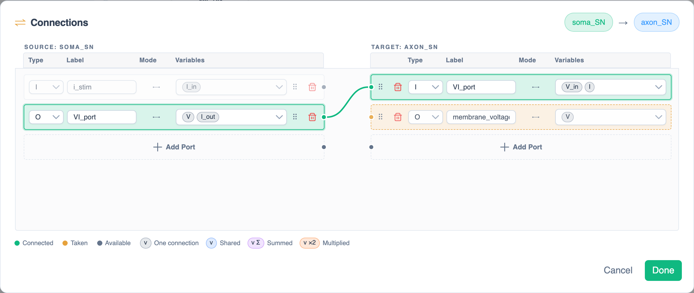

# Port Logic

When you draw a connection, PhLynx **couples** each pair of ports that share a label and have compatible types. The couplings are stored on the connection and used on export.

## Port types {#port-types}

| Source port (arrow tail) | Couples with target port (arrow head) |
| :--- | :--- |
| **Output** (O) | Input, General |
| **General** (G) | Input, Output, General |
| **Input** (I) | General, in the [Connections dialog](#connections-dialog) only |

Input/Output are Circulatory Autogen's Entrance/Exit. A **Basicport** takes one connection; a [Multiport](./glossary.md#multiport) takes several.

## Connections dialog {#connections-dialog}

{.align-center width="800px"}

Double-click a connection to open **Connections**, where each port shows as Connected, Taken (by another connection) or Available. Drag between ports with the same label and compatible types to couple them, or drop onto **Add Port** to create a matching port. Click **Done** to save or **Cancel** to discard.

> [!IMPORTANT]
> A connection with no matching ports shows no warning. Check its couplings here before exporting.
